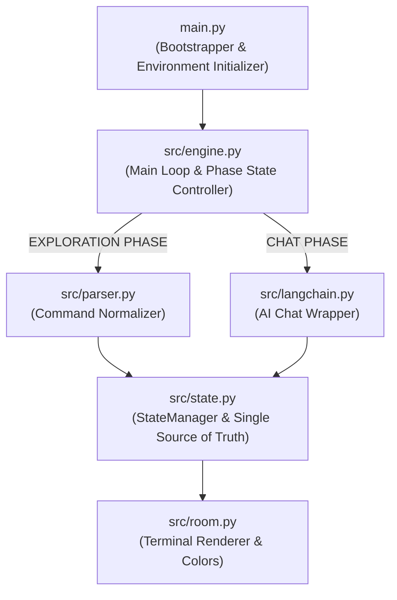
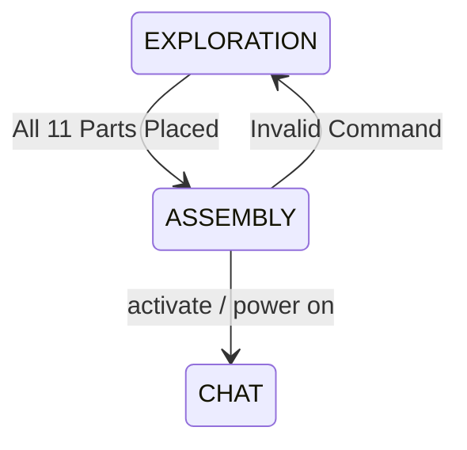

# Architecture & System Design Specification

This document provides a technical overview of the A-maze-ing-Delft engine architecture, module boundaries, data pipelines, state machines, and execution phase transitions.

## Contents

- [System Overview & Core Principles](#system-overview--core-principles)
- [Finite State Machine Architecture](#finite-state-machine-architecture)
- [Detailed Module Specifications](#detailed-module-specifications)
- [Persistence & File Layout](#persistence--file-layout)

## System Overview & Core Principles



## Finite State Machine Architecture

The engine operates on a finite state machine governed by `session["phase"]`.

```text
[ EXPLORATION ] --(All 11 assembly parts placed)--> [ ASSEMBLY ] --(Player runs 'activate')--> [ CHAT ]
```

- **EXPLORATION:** input handled by `src/parser.py`.
- **ASSEMBLY:** validation phase, checks workbench.
- **CHAT:** input routed to `src/langchain.py`.



### Phase Definitions

1. **EXPLORATION Phase**
   - Parser accepts: `look`, `go`, `inspect`, `take`, `use`.
   - State updates inventory, room objects, and room lock flags.

2. **ASSEMBLY Phase**
   - Triggered when `workbench.is_ready == True`.
   - Player issues `activate` or `power on` command in Lab D2 002 (the workbench).

3. **CHAT Phase**
   - Command parser is bypassed.
   - User input routes directly to `src/langchain.py` (ollama, groq, gemini or openai).
   - Response streams directly back to CLI prompt.

## Detailed Module Specifications

### `main.py` — Application Bootstrapper

### `src/state.py` — State Manager & Data Mutations

```text
┌──────────────────────────────────────┐
│          src/state.py                │
├──────────────────────────────────────┤
│ - data: dict (single source of truth)│
├──────────────────────────────────────┤
│ + persist() -> None                  │
│ + auto() -> None                     │
│ + reset() -> None                    │
│ + normalize_state() -> None          │
│ + move(direction) -> bool            │
│ + save(details) -> tuple             │
│ + load(details) -> tuple             │
│ + list_saves() -> tuple              │
└──────────────────────────────────────┘
```

### `src/room.py` — UI & CLI Formatting

#### Standard Terminal Header Layout

```text
================================================================================
LOCATION: Lab D 2001                       | INVENTORY: [secret_key, red_led]
================================================================================
Lab D 2001 - server room and the beating mechanical heart of the whole operation.

Visible Items: None
Exits: [East -> Teacher Room 4]

>
```

## Persistence & File Layout

Directory structure separating template data from player saves:

```text
A-maze-ing-Delft/
├── data/
│   ├── default.json        # Master read-only default game state
│   ├── user.json           # Active session state (written by persist())
│   ├── game.db             # SQLite: users, saves and scoreboard rows
│   ├── guides/             # Per-room walkthrough text (inspect guide)
│   ├── help.json           # CLI `help` command lookup
│   └── saves/              # Serialized save-slot JSON files
├── src/
│   ├── engine.py           # Main loop, phase dispatch and command router
│   ├── state.py            # State: single source of truth + persistence
│   ├── server_state.py     # Lab D 2001 provisioning challenge state
│   ├── langchain.py        # AI chat wrapper (Fred)
│   ├── models/             # user.py, save.py, scoreboard.py (SQLite)
│   └── utils/              # shell, editor, keys, colors, loader, time
└── database.py             # SQLite Database base class
```
