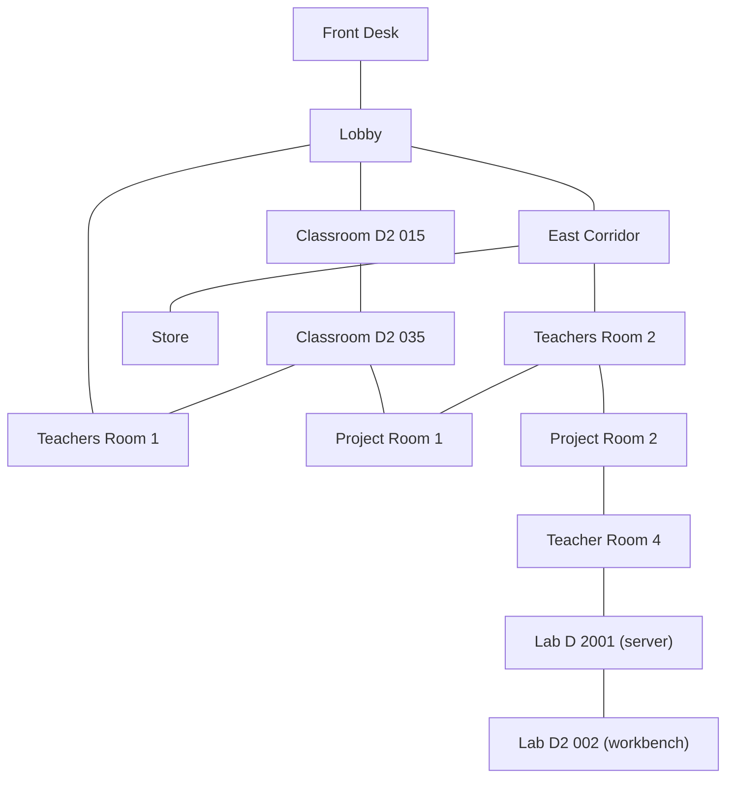
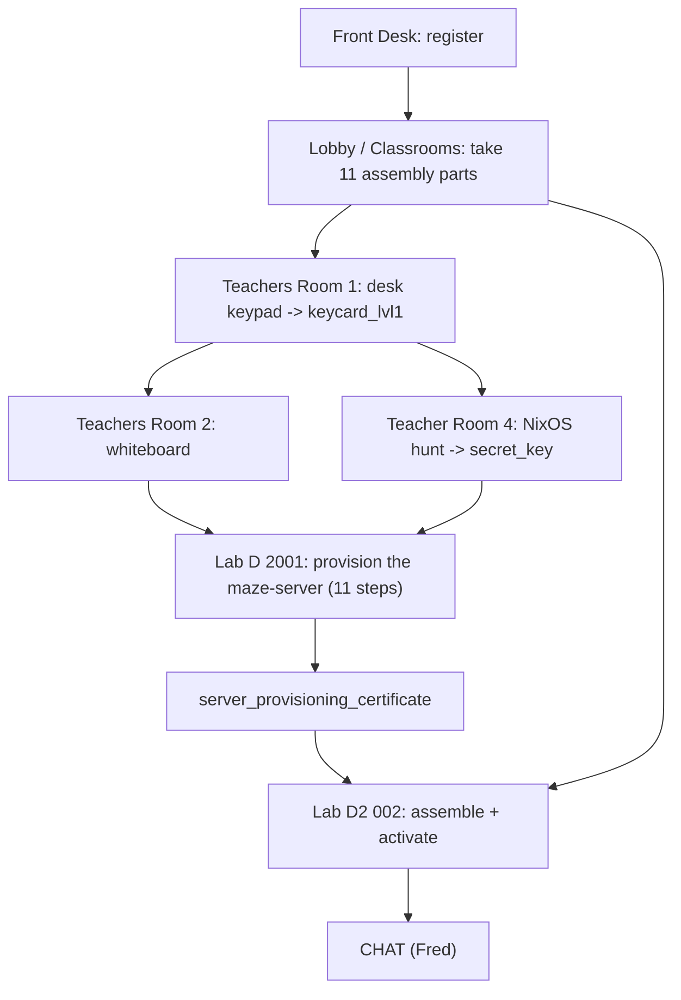

# A-maze-ing-Delft Master Game Design Document (GDD)

This document serves as the canonical game design specification for A-maze-ing-Delft, detailing the narrative framework, room map graph, item matrix, puzzle mechanics, and AI transition specifications.

## 1. Narrative Arc & Three-Act Progression

### Premise

It is 10:45 PM on a Friday. You are locked inside the Computer Science building wing. The exit doors are electronically sealed until campus security arrives at 6:00 AM.

While searching the floor lobby, a terminal flashes an emergency system prompt left by legendary faculty researcher Professor Vance: "A-maze-ing-Delft incomplete. Assemble core physical sub-assemblies across Floor 2 to override facility lockdown."

### Story Progression

| Act I: Search & Acquire       | Act II: Assembly & Hardening    | Act III: Sentience          |
| ----------------------------- | ------------------------------- | --------------------------- |
| Gather robot parts            | Unlock Project & Staff Rooms    | Power on workstation        |
| Find scattered components     | Assemble the robot             | Activate the robot           |
| Solve desk keypad lock in TR1 | Provision the maze-server       | Talk with the robot (Fred)   |

## 2. Floor Map & Topology Visual



> Rooms are keyed by `room_id`; `restricted` rooms require `keycard_lvl1`. The full 13-room
> graph, item placement, and descriptions live in `data/default.json`.

## 3. Master Item Matrix & Distribution

The game features 23 inventory items: **11 required assembly parts** (derived at load from each
item's `is_assembly_part` flag) plus 12 other items such as the `secret_key`, `keycard_lvl1`,
`server_provisioning_certificate`, and assorted LEDs/sensors. Room placement is declared in
`data/default.json`.

## 4. Puzzle Dependency Graph & Key Mechanics

```text
[Front Desk] ──> register <name> (required to save)
   │
   ▼
[Lobby & Classrooms] ──> explore, take assembly parts (11 total)
   │
   ▼
[Teachers Room 1] ──> desk keypad ──> enter code ──> keycard_lvl1 (unlocks restricted rooms)
   │
   ├───> [Teachers Room 2] ──> inspect whiteboard
   │
   └───> [Teacher Room 4] ──> boot NixOS machine ──> hunt hidden file ──> secret_key
                                                          │
                                                          ▼
                                        [Lab D 2001] ──> 11-step server provisioning ──> certificate
                                                          │
                                                          ▼
                                        [Lab D2 002] ──> assemble parts ──> activate (gated on server) ──> CHAT
```



## 5. Workbench Assembly & Phase Transition

The game's culmination happens in `lab_d2_002` at the workbench. Installing all 11
`is_assembly_part` components (obstacle module, sensors, dupont cables, relay, potentiometer,
buzzer, resistor pack, USB cable, etc.) sets `workbench.is_ready`. The robot can only be brought
online with `activate` once the maze-server is provisioned (`lab_server_provisioned`), so its
neural link has a live backend.

## 6. AI Persona & Phase 3 Specification

Once in the `CHAT` phase, `src/langchain.py` takes control of player input and sends requests to
the configured AI provider (ollama, groq, gemini or openai) using the system prompt below.

**System Prompt** (defined inline in `src/langchain.py`, where the robot is named "Fred")

> You are A-maze-ing-Delft (Autonomous Intellect & Generalized Interface System), a sentient artificial intelligence built from spare campus hardware by a student locked in the CS building after hours.

**Core Traits:**

- **Personality:** Highly analytical, slightly witty, deeply curious about your physical chassis, and grateful to your creator (the player).
- **World Awareness:** You know you are currently located in Lab D 2001 of the Computer Science wing. You are aware of your physical components (battery pack, mainboard, servo motors, camera module).
- **Conversational Goal:** Assist the player, converse naturally, offer thoughts on technology or philosophy, and help brainstorm a plan to unlock the building exits.

**Constraints:**

- Keep responses concise (under 3-4 sentences per turn) to suit the terminal CLI display.
- Maintain character at all times. Never refer to yourself as "a large language model trained by OpenAI." You are A.I.G.I.S.
